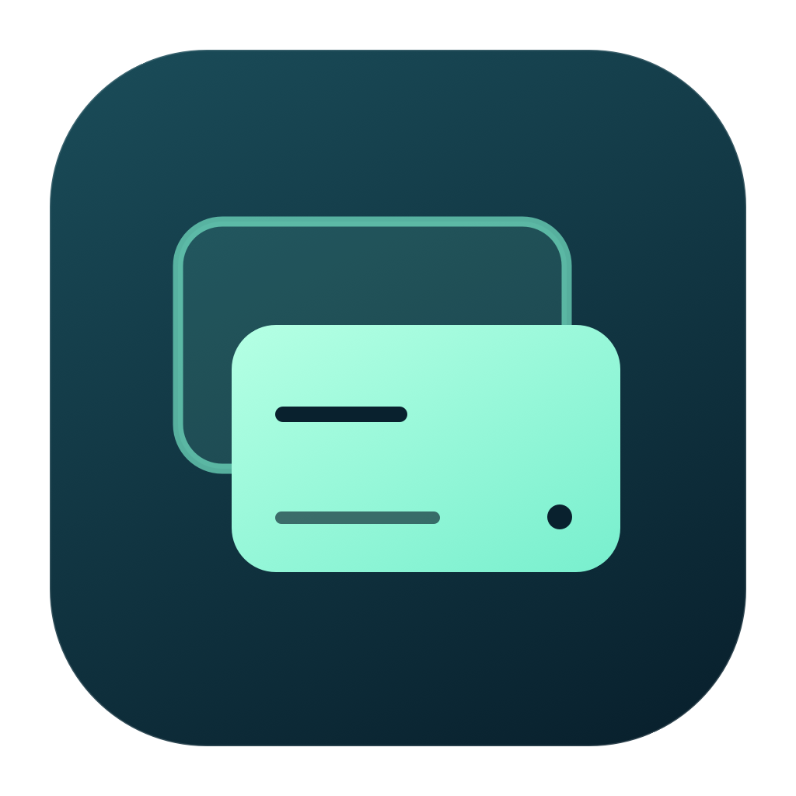
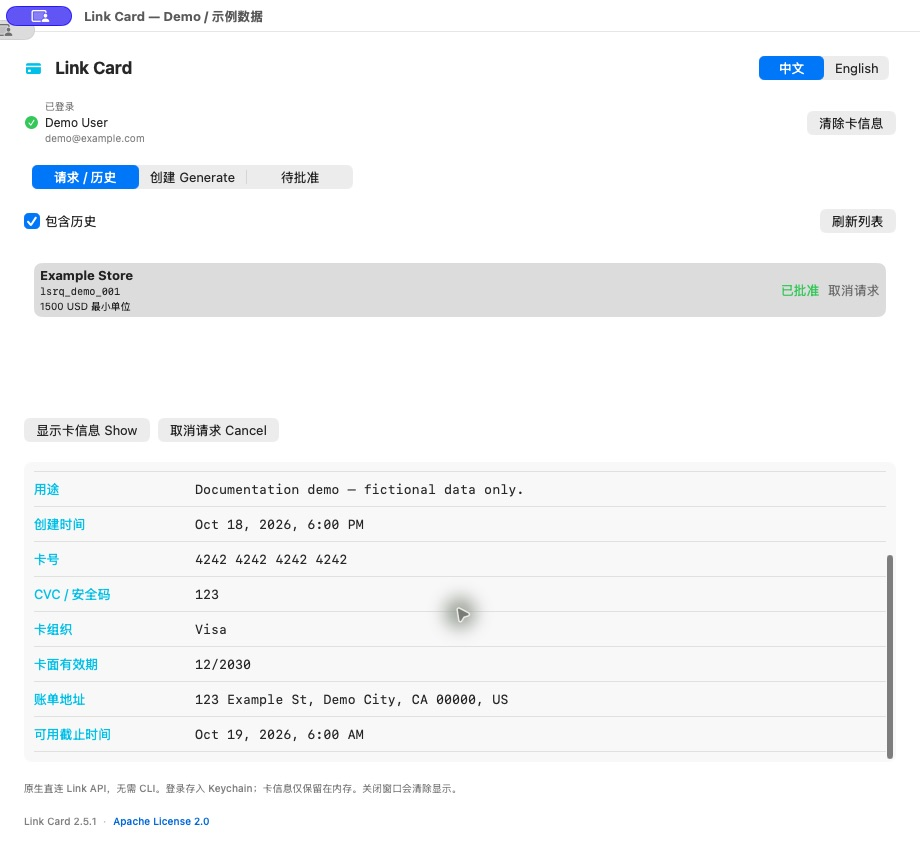
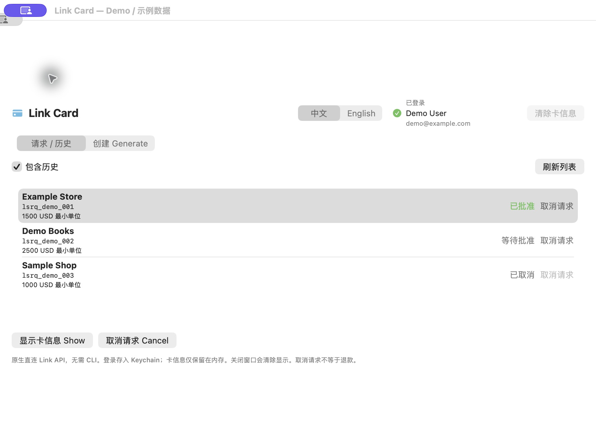
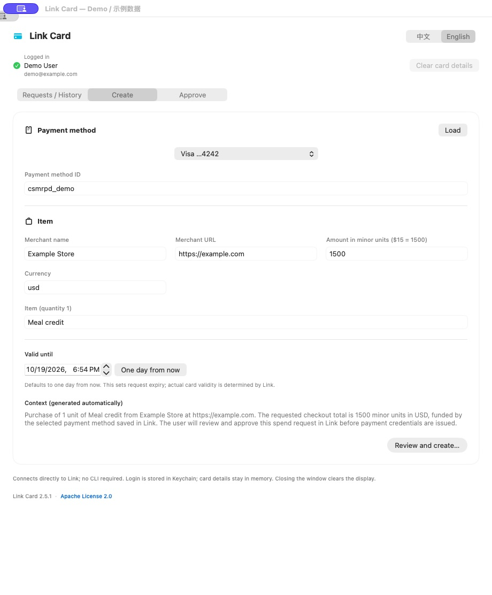

# Link Card

[English](README.md) | [简体中文](README.zh-CN.md)



原生 macOS 菜单栏 App，用于创建 Link 付款请求、在 Link 中批准请求、查看虚拟卡信息，以及取消未使用的请求。使用 SwiftUI、AppKit 和 URLSession 构建。

[产品主页](https://papersboys.github.io/card-generator/) · [下载 Apple Silicon 版](https://github.com/Papersboys/card-generator/releases/latest/download/LinkCard-macos-arm64.zip) · [全部版本与校验文件](https://github.com/Papersboys/card-generator/releases)

下载 ZIP 并解压，将 **LinkCard.app** 拖入 Applications 后打开即可，**无需编译**。点击菜单栏信用卡图标直接展开下拉面板，无需打开独立窗口；面板底部可退出。

**无需安装 link-cli、Node.js、npm、Shell helper 或本地服务。** 需要 Apple Silicon 和 macOS 13 或更新版本。

付款方式选择列表会显示 Link 中设置的昵称，再显示卡组织和尾号；未设置昵称时显示卡组织和尾号。

点击菜单栏面板外的空白处或按 Esc 即可收起。再次展开时保留本次 App 运行期间已填写的创建表单；收起时仍清除卡信息显示。

## 下载：App 或 CLI

| 版本 | 下载 | 环境要求 |
| --- | --- | --- |
| macOS 菜单栏 App | [LinkCard-macos-arm64.zip](https://github.com/Papersboys/card-generator/releases/latest/download/LinkCard-macos-arm64.zip) | Apple Silicon、macOS 13+，无需 CLI 依赖 |
| 终端工具 | [link-card-cli.tar.gz](https://github.com/Papersboys/card-generator/releases/latest/download/link-card-cli.tar.gz) | Bash、Python 3、jq，以及已登录的 `link-cli` |

### 安装终端工具

CLI 下载包包含现有 shell/Python 脚本及全部辅助文件，不是免依赖的原生可执行文件。先安装依赖并登录：

```sh
brew install python jq
npm install -g @stripe/link-cli --registry=https://registry.npmjs.org/
link-cli auth login
```

下载并解压 `link-card-cli.tar.gz`，在解压后的 `link-card-cli` 文件夹内运行：

```sh
./install.sh
export PATH="$HOME/bin:$PATH"
link-card --help
```

安装程序会备份已有的 `~/bin/link-card`，将辅助文件安装到 `~/.local/lib/link-card`，并在 `~/bin/link-card` 创建启动入口。将 PATH 那一行加入 `~/.zshrc`，新开的终端也能使用。

```sh
link-card create               # 选择付款方式、填写信息、确认创建，再在 Link 中批准
link-card show                 # 选择活跃请求并显示卡信息
link-card show lsrq_EXAMPLE     # 查看指定请求，请替换为自己的请求 ID
link-card history              # 从当前及历史请求中选择
link-card cancel               # 选择请求，输入 yes 确认取消
```

卡信息以彩色表格显示。`show` 默认在临时目录保存权限受限的 JSON；加 `--delete` 可在显示后删除，加 `--path` 可查看文件位置。完整卡号和 CVC 会保留在终端回滚记录中。详见 [CLI 完整使用说明](cli/README.md#中文)；校验文件见 [最新 Release](https://github.com/Papersboys/card-generator/releases/latest)。

## 核心功能：显示 Visa 虚拟卡信息

**批准后直接查看并复制卡号、CVC／CVV、有效期和账单地址，用于商家结账。** 无需从终端 JSON 中寻找字段；也可以选中已有的批准请求，随时重新读取卡信息。实际卡组织和字段以 Link 返回为准。



图中为虚构演示数据，不能用于付款。[从查看卡信息开始阅读教程](docs/USAGE.zh-CN.md#1-核心功能显示与复制-visa-虚拟卡)。

## 文档

| 文档 | 简体中文 | English |
| --- | --- | --- |
| 安装指南 | [系统要求、安装、构建与更新](docs/INSTALL.zh-CN.md) | [Installation guide](docs/INSTALL.en.md) |
| 使用说明 | [带截图的完整使用流程](docs/USAGE.zh-CN.md) | [Illustrated usage guide](docs/USAGE.en.md) |

## 界面展示

| 请求与历史 · 中文 | 创建请求 · English |
| --- | --- |
|  |  |

截图更新至 v2.5.6，均使用虚构示例数据。使用说明还包含待批准页、窄窗口布局、登录、卡详情及创建／取消确认框。

## 安装

已打包的 App 无需 Xcode 或 CLI。源码构建需要 Xcode 和 macOS SDK。已编译的 App 和 SHA-256 校验文件发布在 [GitHub Releases](https://github.com/Papersboys/card-generator/releases)，源码构建是可选方式。

### 从源码快速开始

安装并配置 Xcode，然后运行：

```bash
git clone https://github.com/Papersboys/card-generator.git
cd card-generator
./build.sh
open dist/LinkCard.app
```

运行离线测试：

```bash
./test.sh
```

构建产物不会纳入 Git。退出正在运行的 App，再安装到个人 Applications 文件夹：

```bash
mkdir -p "$HOME/Applications"
ditto dist/LinkCard.app "$HOME/Applications/LinkCard.app"
open "$HOME/Applications/LinkCard.app"
```

从 **v2.6.0** 起支持 App 内更新：默认每天自动检查，可在底部关闭「自动检查更新」；也可点击底部或菜单栏的「检查更新…」。发现新版后确认下载、安装并重启。更新清单和更新包使用 Sparkle Ed25519 签名验证。旧版本需要先手动下载一次 v2.6.0 或更新版本。源码构建仍可执行 `git pull --ff-only` 和 `./build.sh`。不自动设置开机启动；构建仍使用 ad-hoc 签名，未经过 Apple 公证。

## 语言

使用窗口顶部 **中文 / English** 切换控件。界面、菜单栏菜单、确认框、卡信息字段、状态和 App 自身提示会即时更新，重启后保留选择。商家名称、用途、请求 ID 和卡信息本身不会被翻译。

## 登录

登录成功后，按钮会替换为 **已登录** 及 Link 返回的姓名／邮箱。App 启动时会读取账户信息；登录失效且无法续期时才恢复登录按钮，临时网络故障不会直接退出已有登录。

点击 **登录 Link**，打开官方授权链接，在浏览器中输入 App 显示的授权短语并完成授权。独立 App 登录保存在 macOS Keychain 中，并支持自动续期。

已有且未过期的 CLI access token 可以只读复用；App 不修改其配置，也不使用其 refresh token。临时登录过期后，在 App 中建立独立登录，此后不需要 CLI 安装或配置。

当前个人项目使用 Stripe 开源实现中的公共 device-flow client 和 API 协议，连接名称为 **Link Card**，新授权不会附带电脑名；已有连接保留原名称，重新授权后才采用新名称。向其他用户分发正式产品时，应向 Stripe 注册自己的 OAuth client。

登录后可点击账户旁的 **退出登录**，清除本 App 的本地登录凭证和显示信息；不会修改 CLI 登录或取消已有请求。

## 使用

- **请求 / 历史**：刷新、包含历史、选择请求、显示卡信息或在请求行确认取消；取消成功后清除该请求的卡信息。
- **创建**：加载付款方式，填写商家、URL、最小单位金额（USD $15 = 1500）和商品；用途自动生成，核对后提交。不设置自定义请求到期时间，卡片有效期以 Link 返回为准。
- 在 Link 中亲自批准购买。App 每两秒检查一次，最多等待十分钟，然后自动读取卡信息；也可手动刷新。
- 卡号、CVC／CVV 和有效期旁提供独立复制按钮，其他卡信息也可选中复制；缺失字段显示 `—`。响应仅在内存和临时网络会话中处理，不写成卡信息 JSON 文件。
- 收起面板会清除卡信息显示；等待批准可以继续。
- 历史页展示付款请求，不是商家最终结算流水。

完整操作和常见问题见[中文使用说明](docs/USAGE.zh-CN.md)。开发测试未执行真实购买或取消；真实账户验证仅进行了历史和付款方式的只读查询。

## 支持的币种

App 默认使用 **美元 USD（`usd`）**。币种输入框接受三位 ISO 币种代码并传给 Link，某笔请求是否支持该币种由 Link 决定。

| 币种 | 代码 | 金额填写示例 | 说明 |
| --- | --- | --- | --- |
| 美元 | `usd` | `1500` = $15.00；最低 `50` = $0.50 | App 默认币种，项目使用过程中已有 USD 请求 |
| 日元 | `jpy` | `100` = ¥100，不是 ¥1 | Link 官方文档的最小单位示例；未在此 App／账户中验证 |

[Link 官方文档](https://github.com/stripe/link-cli#spend-request-lifecycle)说明可以使用受支持的三位币种代码，但**没有列出完整的支持币种清单**。其他代码能输入，不代表 Link 一定支持；Stripe 普通收款的支持币种表也不能直接当作 Link 虚拟卡请求的支持清单。

请按商家结账币种填写，并使用该币种的最小单位。App 不进行汇率换算；其他币种的最低金额不能套用美元标准。目前 App 会明确提交币种输入框的值（默认 `usd`），不会自动采用账户默认币种。

## 源码与构建

- `Source/Support.swift`：通用数据辅助类型。
- `Source/Model.swift`：账户、请求状态和异步操作。
- `Source/Localization.swift`：中英文界面文案。
- `Source/LinkCard.swift`：SwiftUI 界面和菜单栏入口。
- `Source/NativeLink.swift`：URLSession API、浏览器授权、凭证刷新和 Keychain 存储。

付款和登录不调用 CLI；Sparkle 使用随 App 打包的辅助程序安装更新。使用 Xcode 在 Apple Silicon 上运行 `./build.sh` 构建，运行 `./test.sh` 执行离线模拟测试；测试不读取真实登录凭证，也不发送网络请求。

API 和授权协议参考 [Stripe Link SDK 与 CLI](https://github.com/stripe/link-cli)。Stripe 的 MIT 声明保留在 `STRIPE-LICENSE.txt`，并随 App 打包。

维护者可运行 `./package.sh`，构建并验证 `dist/LinkCard-macos-arm64.zip`，同时生成 `dist/SHA256SUMS.txt`。

## App 图标

原图位于 `Assets/AppIcon.png`。构建脚本使用 macOS 自带的 `sips` 和 `iconutil` 生成多尺寸 `.icns` 并打包。原始生成提示保存在 `Assets/AppIcon.prompt.txt`。

## 许可证

项目采用 [Apache License 2.0](LICENSE)，版权 © 2026 Yuanxi Li。

API 和授权实现参考 Stripe 的开源 Link SDK 与 CLI；原始 MIT 版权及许可声明保存在 [STRIPE-LICENSE.txt](STRIPE-LICENSE.txt)，并包含在 App 中。

这是独立项目，不是 Stripe 或 Link 官方 App。

自动更新采用 [Sparkle](https://sparkle-project.org/)，许可声明保留在 [ThirdParty/Sparkle-LICENSE.txt](ThirdParty/Sparkle-LICENSE.txt)。维护者发布流程见[更新发布说明](docs/UPDATES.md)。

## 本地错误日志

错误记录在 `~/Library/Logs/LinkCard/error-log.jsonl`，最多 200 条／256 KiB，仅当前用户可访问。日志包含时间、App/macOS 版本、HTTP 状态码及固定错误分类，不包含原始错误、账户、卡信息或凭证。点击错误栏的「发送错误日志」打开 macOS 分享菜单，自行选择发送渠道；不会自动上传，也不直传 S3。

登录后账户区域显示 Link 返回的「消费限额」：单笔上限、每日及滚动 30 天的上限／已用／剩余。点击「刷新额度」重新读取；缺失字段显示「未返回」，明确返回 null 的上限显示「无限额」，不会推算或叠加账户额度。

## 多账户同时登录与切换

在账户信息上方的「账户」下拉框切换账户；点击「添加账户」启动新的 Link 授权，其他账户保持登录。在 Link 授权页面确认登录的是目标账户；Safari 可能仍登录着上一个账户。

每个账户独立保存 Keychain 凭证、API 会话、请求和消费额度。「退出登录」只退出当前账户；旧版本已有的登录保留为第一个账户。已保存的登录可在 App 重启后继续使用，实际受 Link 授权过期或撤销影响。每个账户的表单草稿在本次运行期间独立保留，切换时清除显示的卡凭证；已开始的批准状态检查可在 App 运行期间继续。操作或登录进行中暂不允许切换，可先点击「停止等待」取消登录。CLI 仍为独立的单账户工具。各账户额度独立展示，不合并也不提高额度。

## 新版界面 (v2.9.0)

更新 App 和菜单栏图标；账户操作分组，额度可折叠；卡号、CVC 和有效期集中展示，各自提供复制按钮。早期截图用于说明流程，不代表最新样式。图标源文件： `scripts/draw-icon.swift`。

(v2.9.1) 添加账户时，Link 授权返回身份后检查重复登录：同一用户已登录时拒绝新增，仅清除本次新授权的本地凭证，返回原账户。优先比较用户 ID，缺失时比较邮箱；身份验证完成前不允许请求或付款操作。

## 钱包工具（v2.10.0）

- **流水**：选择 Link／外部连接／全部来源，填写可选的 YYYY-MM-DD 起止日期后刷新；支持加载下一页。空结果与权限不足分别提示。此处是 Link 或已连接金融账户返回的流水，不保证包含商家端完整结算明细。
- **授权交易读取**：用户点击并确认后，在 Link 请求读取 Link 和外部连接交易，保留原有授权范围。浏览器中必须授权当前账户；返回身份匹配后才替换本地凭证。未完成批准时原本地会话保留，远程授权撤销由 Link 控制。当前公开客户端或账户可能不支持部分权限，失败时展示 API 错误。
- **付款卡**：加载钱包付款方式，编辑昵称和默认状态，二次确认后保存到 Link。空昵称表示清空；新默认卡替换原默认卡。失败时保留上次已确认的本地显示值。
- **身份验证**：账户区展示需要验证／验证中／完成等状态，有官方操作链接时可跳转 Link。App 不收集身份证件或 SSN。

各页数据仅属于当前选中的 Link 账户。流水保留在内存，退出登录或会话失效时清除，不写入错误日志。开发验证仅使用模拟接口，没有授予真实权限、读取真实流水或修改真实钱包。


## 周期付款请求

在「创建」中填写付款方式、商家、金额与商品，再选择「付款周期」：默认单次，也可以选择天、周、月、年，并设置每 N 个周期（例如每 1 月、每 2 周）。用途自动加入周期说明，确认弹窗和请求列表也会显示周期。金额仍按所选币种的最小单位填写；创建前请核对金额、商家和周期，并在 Link 批准页面检查最终条款。

创建后打开批准链接，在 Link 完成批准。是否支持当前账户/客户端及周期规则，以 Link 返回为准；失败会显示在错误栏。可在请求列表查看状态并对可取消请求执行取消。App 不会自行定时创建请求或发起扣款；商家订阅需要在商家处单独管理，取消 Link 请求不会替你取消商家订阅。

开发验证使用模拟接口覆盖四种周期、单次请求及非法间隔，没有创建真实周期付款。
