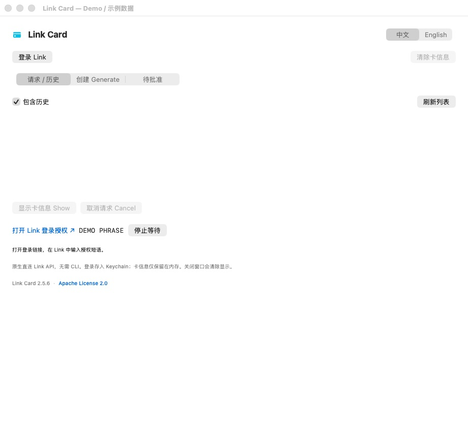

# Link Card 安装指南

[English](INSTALL.en.md) | [简体中文](INSTALL.zh-CN.md)

安装后，从 macOS 顶部菜单栏的信用卡图标打开 App。Link Card 直接连接 Link API，不需要安装 `link-cli`、Node.js 或 npm。

## 选择安装方式

| 你手里有什么 | 使用哪种方式 |
| --- | --- |
| 已打包的 `LinkCard.zip` 或 `LinkCard.app` | 按「方式一」安装，无需 Xcode |
| Git 仓库或源码 ZIP | 按「方式二」先构建，再安装 |

仓库不跟踪 `.app` 或打包 ZIP，也没有自动下载二进制的安装脚本。只有源码时，请使用方式二。

## 系统要求

| 项目 | 要求 |
| --- | --- |
| Mac | Apple Silicon，例如 M1、M2、M3、M4 系列；当前脚本固定构建 `arm64` |
| macOS | 13 或更新版本 |
| 网络 | 登录、读取账户和付款请求时需要能访问 Link 官方服务 |
| 账户 | 可以使用相应 Link 功能的个人账户；具体可用功能由 Link 决定 |
| 从源码构建 | Xcode、macOS SDK 和 Swift 编译器；当前项目已使用 Swift 6.2 构建验证 |

仅运行已构建的 App 不需要 Xcode。当前构建脚本没有提供 Intel Mac 或 Universal 版本。

## 方式一：安装已打包的 App

1. 如果拿到的是 `LinkCard.zip`，在 Finder 中双击解压。
2. 将 `LinkCard.app` 拖入 **应用程序 / Applications**，或个人主文件夹下的 **Applications** 文件夹。
3. 双击安装后的 `LinkCard.app`。
4. 窗口打开后，确认顶部菜单栏出现信用卡图标。

当前 App 使用本地 ad-hoc 签名，未经过 Apple 公证；收到的文件也应当来自你信任的构建来源。若 macOS 或受管理设备阻止打开，先检查文件来源及系统提示，也可以使用下方源码构建方式；不要直接关闭系统安全保护。

## 方式二：从源码构建

### 1. 准备 Xcode

安装 Xcode，并至少打开一次，完成它要求的首次设置。

在终端检查当前开发工具：

```bash
xcode-select -p
xcrun --find swiftc
xcrun --show-sdk-path
```

如果机器安装了多个 Xcode，或当前选中了其他开发工具目录，请选择你实际安装的 Xcode。常见路径对应的命令是：

```bash
sudo xcode-select --switch /Applications/Xcode.app/Contents/Developer
```

如果 Xcode 不在这个位置，请使用自己的安装路径。首次构建若提示许可证或附加组件未就绪，先打开 Xcode 完成设置，再重试。

### 2. 获取源码

```bash
git clone https://github.com/Papersboys/card-generator.git
cd card-generator
```

如果已经有本地仓库，直接进入该目录即可；不用重复 clone。

也可以解压源码 ZIP，在终端进入包含 `build.sh` 和 `Info.plist` 的项目根目录。

### 3. 构建

```bash
./build.sh
```

脚本会编译 Swift 源码、生成 App 图标、组装 App、执行本地签名并验证。成功后终端会显示类似：

```text
Built: /path/to/card-generator/dist/LinkCard.app
```

先直接试运行：

```bash
open dist/LinkCard.app
```

可选：运行离线测试。这些测试使用模拟 API，不会创建真实请求或扣款。

```bash
./test.sh
```

### 4. 安装到个人 Applications 文件夹

如果 App 已经打开，先从菜单栏图标中选择 **退出 / Quit**，再复制：

```bash
mkdir -p "$HOME/Applications"
ditto dist/LinkCard.app "$HOME/Applications/LinkCard.app"
open "$HOME/Applications/LinkCard.app"
```

这组命令会安装或替换个人 Applications 文件夹中的 LinkCard；以后从该位置打开即可。也可以用 Finder 将构建好的 App 拖入系统的 `/Applications`，按系统要求授权。

## 首次启动与登录

1. 点击 **登录 Link / Log in to Link**。
2. 点击官方授权链接，在浏览器中登录自己的 Link 账户。
3. 按页面要求输入 App 显示的授权短语并完成授权。
4. 返回 App，等待右上角显示 **已登录 / Logged in** 和账户姓名／邮箱。
5. 使用顶部 **中文 / English** 控件切换语言。

账户登录会保存到 macOS Keychain；语言偏好会在重启后保留。不要把自己的授权短语、登录凭证或完整卡信息放入 Git。



登录完成后，继续阅读[带截图的使用说明](USAGE.zh-CN.md)，了解创建、批准、显示卡信息和取消请求的步骤。

## 菜单栏与退出

- 点击菜单栏信用卡图标 → **打开 Link Card / Open Link Card**，重新显示窗口。
- 关闭窗口不会退出 App，也不会取消服务端请求。
- 点击菜单栏图标 → **退出 / Quit**，完全退出。
- 安装不会自动设置登录启动。

## 更新已安装的 App

1. 从菜单栏退出正在运行的 Link Card。
2. 进入自己的源码仓库；先保存本地修改，再更新源码：

   ```bash
   git pull --ff-only
   ./build.sh
   ```

3. 将新构建的 `dist/LinkCard.app` 复制到原安装位置，替换旧版。
4. 重新打开 App，检查账户和语言设置。

使用个人 Applications 目录时，可以复用：

```bash
ditto dist/LinkCard.app "$HOME/Applications/LinkCard.app"
open "$HOME/Applications/LinkCard.app"
```

替换 App 不会主动删除 Keychain 登录或语言偏好。签名或系统访问权限发生变化时，可能需要重新确认 Keychain 访问或在 App 中重新登录。

如果使用的是别人提供的打包版本，取得新版本后退出旧 App，再替换原来的 `.app`；当前 App 没有自动更新功能。

## 常见安装问题

| 情况 | 检查与处理 |
| --- | --- |
| 找不到 `swiftc` 或 macOS SDK | 安装并打开 Xcode，检查 `xcode-select -p` 和 `xcrun --show-sdk-path` |
| 提示 Xcode 许可证或附加组件未完成 | 打开 Xcode 完成首次设置，再重新构建 |
| `./build.sh: permission denied` | 在项目根目录运行 `chmod +x build.sh test.sh`，再执行脚本 |
| 找不到 `build.sh` | 当前目录不对；进入包含 `Source/`、`build.sh` 和 `Info.plist` 的项目根目录 |
| 安装位置没有写入权限 | 使用个人的 `$HOME/Applications`，或在 Finder 中按系统提示授权 |
| 下载的 App 无法打开 | 确认来源、解压是否完整和系统提示；也可以从源码构建。不要通过关闭系统安全保护解决 |
| 启动后没有 Dock 图标 | 这是菜单栏 App；请找屏幕顶部的信用卡图标 |
| 关闭后找不到窗口 | 从菜单栏图标选择「打开 Link Card」 |
| 显示多个同名 App | 确认已退出旧版，以后固定从安装目录启动，避免同时打开 `dist/` 和已安装副本 |
| 登录过期或账户信息暂不可用 | 按 App 提示检查网络或重新登录；详细流程见使用说明 |
| 在 Intel Mac 上无法运行 | 当前脚本只构建 Apple Silicon，不支持 Intel；需要另行适配和验证 |

## 卸载

1. 从菜单栏选择 **退出 / Quit**。
2. 在 Finder 中将安装位置的 `LinkCard.app` 移到废纸篓。

删除 App 不会取消付款请求，也不会退款。如果不再使用此 App，可自行在 Link 的已连接应用中移除相应授权；本机 Keychain 登录项和语言偏好也不会因删除 `.app` 自动清除。
