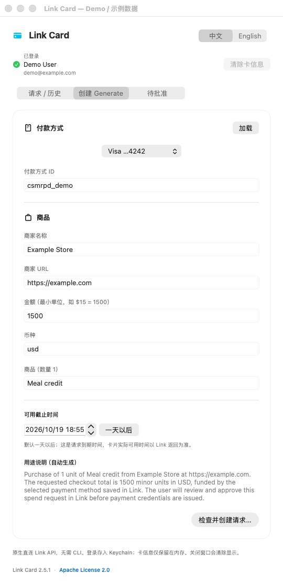
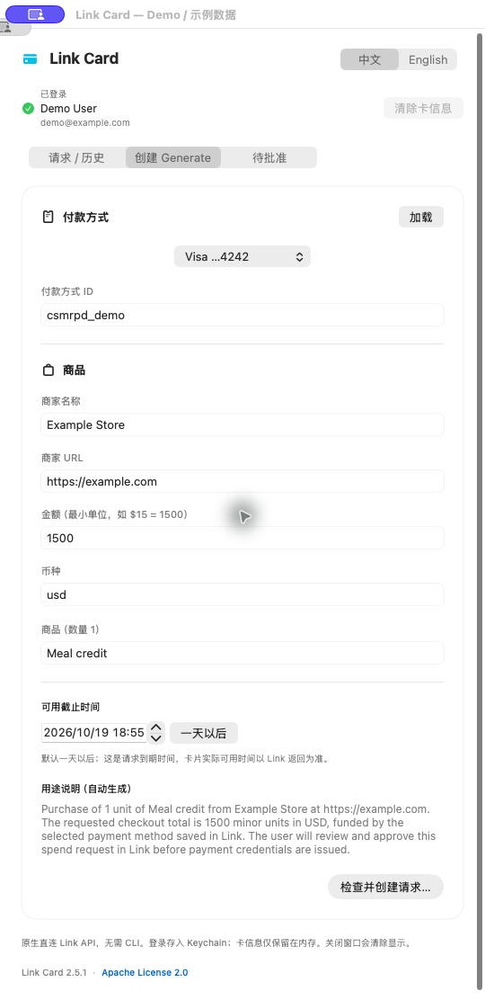
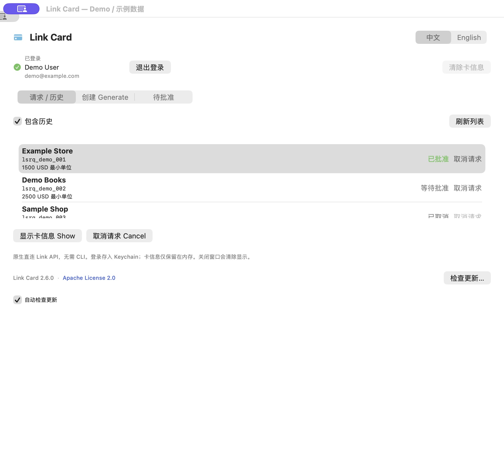
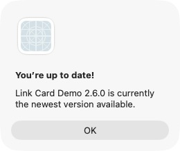
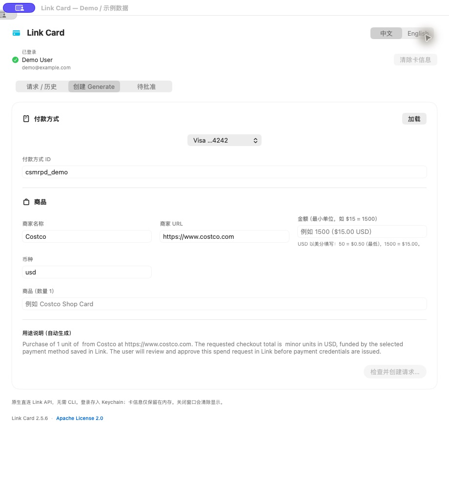
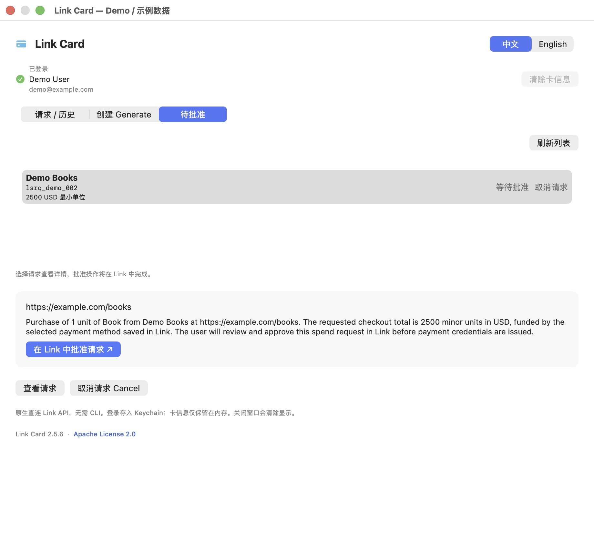
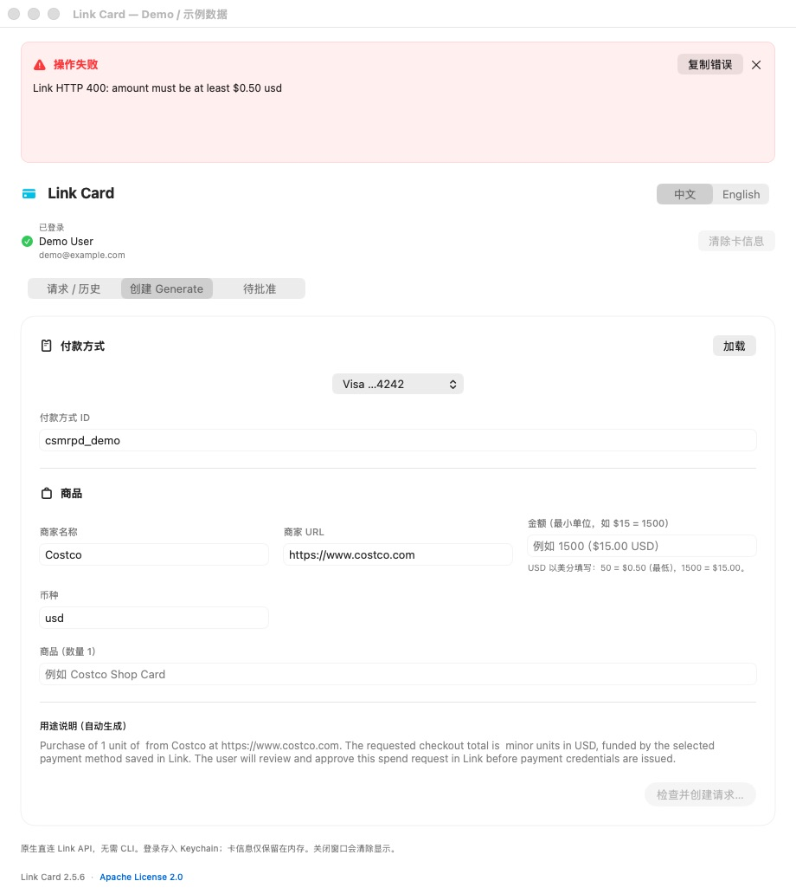

# Link Card usage guide

[English](USAGE.en.md) | [简体中文](USAGE.zh-CN.md)

Link Card is a macOS menu-bar app for creating Link spend requests, retrieving approved virtual card details, and canceling requests. It does not place merchant orders or submit merchant checkout forms for you.

> Screenshots come from an offline demo using the actual interface code. Accounts, authorization phrases, requests, and card details are fictional; Costco is shown as the default example merchant and cannot be used for payment. Screenshots show both available interface languages; the English button names below correspond to their Chinese counterparts.

For first-time setup, follow the [installation guide](INSTALL.en.md).

## 1. Core feature: view and copy Visa virtual card details

**After approval, see the card number, CVC/CVV, expiration date, and billing address, ready to copy into the merchant's checkout.** The example shows a Visa virtual card; the actual network and available fields depend on Link's response.

*Every account and card field shown is fictional, not a real payment credential.*

Missing fields display as `—`:

| Field | Meaning |
| --- | --- |
| Card number | Virtual card number returned by Link |
| CVC | Virtual card security code, also called CVV |
| Expiration | Card expiration month/year |
| Billing address | Billing address returned by Link |
| Brand | Card network |
| Valid until | The actual credential deadline returned by Link; missing values display as `—`. This is separate from request expiry and card expiration |
| Request expiry | The request expiry returned by Link |
| Spend request ID | The request ID, typically starting with `lsrq_` |
| Status | Current request status |
| Merchant / Merchant URL | Merchant information supplied when creating the request |
| Context | Purchase purpose |
| Created at | Request creation time |

### Already have an approved request?

1. Select **Requests / History**.
2. Click **Refresh list**.
3. Select the request.
4. Click **Show card details**.

Use the separate **Copy** buttons beside Card number, CVC/CVV, and Expiration. Each shows Copied after copying its value for checkout. Missing values cannot be copied. You can also select text and press **⌘C**. The app does not automatically copy or fill merchant forms. Full card numbers and CVCs appear directly in the panel.

Click **Clear card details** to clear the display. Closing the panel also clears displayed card details; pending approval checks can continue, without canceling the server-side request. Card responses use an ephemeral network session and are not written to credential JSON files.

First time here? Continue with launch, login, creation, and approval below. Pending requests do not expose full card details.

## 2. Menu bar dropdown panel

Launch **LinkCard.app**, then click the credit-card icon in the macOS menu bar to expand the panel. From v2.7.0, the app no longer opens a separate main window.

- Click the icon again, click outside the panel, or press Esc to close it.
- View, create, approve, log out, and check for updates in the panel. Scroll to reach more content.
- Right-click the icon for shortcuts including Check for Updates… and Quit. Quit is also available at the bottom of the panel.
- Closing the panel clears displayed card details and keeps existing requests in Link. Approval checks can continue; reopen the panel after approval to retrieve card details.

### Change language

Use **中文 / English** at the top of the panel. Controls, menu-bar items, confirmations, card field labels, and existing status messages update immediately. Your choice survives restarts. Merchant names, purchase context, IDs, and card data are preserved.

### Panel layout and editing shortcuts

The panel fits the available screen area and scrolls vertically. Older screenshots below illustrate field content; from v2.7.0 the actual interface is a menu bar dropdown panel.

| Narrow single-column form | Scroll to the bottom |
| --- | --- |
|  |  |

All text input fields support **⌘C Copy, ⌘V Paste, ⌘X Cut, ⌘A Select All, ⌘Z Undo, and ⇧⌘Z Redo**, also available through the macOS Edit menu. Click a field first; use ⌘A followed by paste to replace its contents. The payment-method ID can be pasted or edited after selecting a method. Context is generated automatically and can be selected and copied; it needs no manual entry.

### Automatic updates (v2.6.0 onward)

Use Check for Updates… and the Automatically check for updates toggle in the footer. A check command is also available in the menu bar. Automatic checks run daily by default; manual checks remain available when disabled. Follow Sparkle's update dialog to download, install, and relaunch; finish current work before installing. Both the feed and archive are signature-verified. Older builds need one manual download to gain this feature.

## 3. Log in to Link

1. Click **Log in to Link** below the title.
2. Click **Open Link authorization ↗** to open the official Link website.
3. Sign in to your account and enter the app's authorization phrase if requested.
4. Return to the app. The login button is replaced by **Logged in** and the name/email returned by Link.

*The authorization phrase in this screenshot is only an example.*

On launch, the app checks the session and loads account details. If authentication expires and cannot be refreshed, the login button returns. Temporary network failures do not automatically sign you out; the app reports when account information is unavailable.

Authorizing the app and approving an individual purchase are separate steps. The independent app login is stored in macOS Keychain. No CLI, Node.js, or npm is required.

An existing unexpired CLI access token can be reused read-only without changing its configuration or using its refresh token. Once it expires, use the app's login button to establish an independent session.

### Log out

After signing in, click **Log out** beside the account information. This removes the app's Keychain credentials, clears account/card details and local lists, and stops approval checks. Log in to Link becomes available again. The app will not silently reuse a CLI login on restart after an explicit logout; sign in again to view existing server-side requests.

This signs out of this app only. It does not modify CLI configuration, sign out of Link in your browser, or cancel existing requests. Manage connections in Link if you want to revoke the server-side authorization.

## 4. Create a spend request

First confirm the item and final checkout total on the merchant's website. Then:

1. Select **Create**.
2. Click **Load** beside Payment method.
3. Select a method from the dropdown. Its ID fills automatically; you can also enter an existing payment-method ID manually.
4. Complete the form. Merchant name and URL default to **Costco** and **https://www.costco.com**, and remain editable. Amount and item examples are placeholders; enter the actual checkout amount and item.

USD amounts use cents: the minimum is `50` ($0.50); `1500` = $15.00 and `50000` = $500.00. Placeholder examples are not submitted values. Generated context updates as you edit the purchase fields.

*With currency `usd`, an amount of `1500` represents $15.00.*

| Field | What to enter | Example |
| --- | --- | --- |
| Payment method ID | The Link funding method, not a spend-request ID | Select from the dropdown |
| Merchant name | Actual merchant; defaults to Costco and is editable | Costco |
| Merchant URL | Complete HTTP/HTTPS URL; editable Costco default | `https://www.costco.com` |
| Amount | A positive integer in the currency's minor units | For USD $15.00, enter `1500` |
| Currency | Three-letter currency code | `usd` |
| Item | Purchase description; quantity is currently fixed at 1 and commas are not allowed in the name | Meal credit |
| Context | Generated automatically from merchant, URL, item, amount, and currency; no typing required | Review before creation |

5. Click **Review and create…**.
6. Check the merchant, URL, amount, item, and context in the confirmation dialog.
7. Click **Create and request approval**. Filling in the form alone does not submit a request.

*Choose Back to return and edit the form.*

Interpret the amount together with its currency: `10000` in `usd` means $100.00, not $10,000. Request amounts and statuses are not necessarily the merchant's final settlement amount.

This client does not support custom request expiry. Creation omits `expires_at`; card expiration and credential validity are determined by Link.

## 5. Approve and automatically show card details

1. After creation, the **Approve** tab opens. Click **Approve in Link ↗**. You can also select earlier pending requests here to review their merchant, amount, and generated context. If no link is available yet, click **Get approval link**.
2. Review and personally approve the request on the official Link page.
3. The app can continue checking while the panel is closed. The app checks every two seconds for up to ten minutes and retrieves card details after approval when the panel is open; otherwise, reopen the panel to retrieve them.
4. If the display does not update, click **Refresh after approval**, or select the request and click **Show card details**.

**Return to an earlier request:** Open Approve, click Refresh list, and select a request to review its merchant URL, requested amount, and context. Use Get approval link if none is shown. Review request reloads its status and starts waiting for approval. Approved requests leave the pending list after refresh; use Requests / History to view their card details. An empty-state message appears when no requests need approval.

The app does not approve purchases for you. Reaching the ten-minute polling limit only stops automatic checks; it does not cancel the request.

## 6. Cancel a request

1. Select the request in **Requests / History**.
2. Click **Cancel request** in that row, or use the button below the list. Only created, pending-approval, or approved requests can be canceled.
3. Verify the merchant and request ID, then confirm **Cancel request**.
4. After Link confirms cancellation, the app clears the corresponding card display and stops approval polling. Canceled requests leave the active list; enable **Include history** to view them. Refresh to reload server state.

*Review the merchant and ID before confirming. No cancellation was submitted for this screenshot.*

The server can reject cancellation in some states; the app displays the error.

## 7. History

Enable **Include history** to reload past requests, including canceled and expired ones. You can select a record and try retrieving details, but full card credentials may no longer be available.

This is **spend-request history**. Row amounts are request amounts, not a dedicated query of actual merchant charges. The app currently has no separate merchant transaction ledger, refund tracker, or reconciliation view. Compare merchant receipts with the final posted funding-method transaction when checking actual charges.

## Troubleshooting

Errors appear in a persistent red banner at the top of the panel. It keeps the specific Link error through tab changes, refreshes, and scrolling. Use Copy error to copy the text, or × to dismiss it. Failed creation preserves the form and does not switch to Approve.

For `amount must be at least $0.50 usd`, enter at least `50` for USD. A rejected creation does not produce a request to approve. If an older build reports `expires_at is not supported for this client`, quit and update to v2.5.6 or later; custom expiry has been removed from creation.

| Situation | What to do |
| --- | --- |
| No active requests | Enable Include history or create a request |
| No payment methods | Check the account, click Load, and follow any account/payment-method instructions returned by Link |
| Create button is disabled | Check required fields, whether another action is running |
| Invalid amount or URL | Use positive integer minor units and a complete `http://` or `https://` URL |
| `pending_approval`, with no card number | Open that request's approval link, approve it, then refresh |
| Expired login or HTTP 401 | Use Log in to Link, then refresh |
| Card number, address, or CVC is `—` | The response did not include that field; check approval/status rather than inferring its value |
| Details disappeared after closing the panel | Reopen from the menu bar, select the request, and show details again |
| Creation returned an error | Refresh active requests and history before retrying, to avoid duplicate submissions |

## Current scope

- Apple Silicon, macOS 13 or later.
- Persistent Chinese/English switching.
- One item per request, quantity fixed at 1.
- No automatic merchant checkout, approval, launch at login, or refund operation.
- Local ad-hoc signing, without Apple notarization.

If `refresh_token is not active: status: revoked` appears, the saved refresh credential is no longer valid. From v2.5.7 onward, Log in to Link becomes available again; use it to authorize a fresh session. Do not share tokens.

### Missing approval link or phone notification

Update to v2.7.4 or later. Refresh the Approve tab, select the request, and click Get approval link. Requests in created, pending_approval, or requires_action are included. Open the returned Link approval URL, approve in Link, then refresh card details. If recovery fails, inspect the error banner before creating a duplicate request.

## Multiple Link accounts

Use the Account picker above the account header to switch accounts. **Add account** starts a new Link authorization without logging out the others. On the Link authorization page, choose or sign in to the intended account; Safari may already be signed in to another account.

Each account has its own Keychain token entry, API session, requests and spend limits. Log out affects only the selected account. Existing login is retained as the first account. Saved logins survive app restarts, subject to Link expiry or revocation. Form drafts are preserved per account during the current app session; displayed card credentials clear on switching. Pending approval checks already started can continue for other accounts while the app runs. Switching is disabled during an active operation or login; use Stop waiting to cancel login first. The CLI remains a separate single-account tool. Account limits are displayed independently and are not pooled or increased.

### Canceling a terminal request

A terminal-state HTTP 409 triggers a status refresh, disables repeat cancellation and clears displayed credentials for that request. Inactive requests are removed from the active list; enable history to inspect their status. A failed status refresh is reported explicitly, never as successful cancellation.

## Refreshed interface (v2.9.0)

New linked-card artwork in the app icon, menu bar and header; grouped account controls; collapsible spend limits; icon navigation; card number, CVC and expiration grouped with individual Copy buttons; actionable empty states. Earlier screenshots illustrate the workflow rather than the current styling. Reproducible icon source: `scripts/draw-icon.swift`.

Duplicate account protection (v2.9.1): after Link authorization returns the identity, Add account rejects an already-signed-in user, removes only the newly authorized local session, and returns to the existing account. User IDs are compared first, with normalized email as a fallback. Payment/request operations are blocked until the new identity is verified.

## Wallet tools (v2.10.0)

- **Activity:** choose Link, external-connection, or all transactions; optionally enter YYYY-MM-DD start/end dates, refresh, and load subsequent pages. Empty results and insufficient permissions are distinct. Data comes from Link or connected financial accounts and is not a full merchant settlement ledger.
- **Authorize transactions:** explicitly requests read_link_transactions and read_external_transactions in Link, merged with existing granted permissions. Confirm the current account in the browser. The previous local token is replaced only after the returned account matches. Canceling before approval keeps the existing local session; Link controls remote grant revocation. This public client/account may not support every requested permission, in which case the API error remains visible.
- **Cards:** load wallet payment methods; Edit opens nickname/default controls. A second confirmation saves both fields to Link. Empty nickname clears it; choosing a new default replaces the previous wallet default. Failures preserve the last confirmed local values.
- **Verification:** the account area shows the returned requirement or pending/completed status and a trusted Link action URL when provided. Complete verification on Link; this app does not collect identity documents or SSNs.

All views remain isolated to the selected Link account. Transaction data stays in memory and is cleared on logout/session invalidation; it is not included in local error logs. Implementations follow the official stripe/link-cli SDK resources. Offline tests cover APIs and state transitions; no live permission grants, financial reads, or wallet updates were performed during development verification.

## Recurring payment requests

In Create, enter the payment method, merchant, amount and item, then choose Payment frequency. One-time is the default; day, week, month and year support an interval count (for example every 1 month or every 2 weeks). The generated context, confirmation and request list show the schedule. Enter amounts in the selected currency's minor units; check the amount, merchant, schedule and final terms on Link's approval page.

Open the approval link after creation and approve in Link. Account/client support and recurrence rules are determined by Link; failures appear in the error banner. Review status and cancel eligible requests in the request list. The app does not schedule requests or initiate charges itself. Manage merchant subscriptions separately: canceling a Link request does not cancel a merchant subscription.

Developer validation uses mocked APIs for all four intervals, one-time requests and invalid counts. No real recurring payment was created.

## Merchant templates, subscriptions and status notifications (2.12.0)

### Merchant templates

1. In Create, enter the merchant, URL, item, amount, currency and one-time or recurring settings.
2. Expand Merchant templates, name the template and choose Save current form.
3. Select a saved template next time to populate purchase fields. Selecting a template replaces those fields.
4. Save again to update the selected template, or delete it. Saving does not create a payment request.

Templates are stored in local preferences per App account slot and survive restarts without cloud sync. They exclude payment method IDs, card numbers and CVCs. Logging out retains that slot's templates. Select a payment method and review/approve each new request in Link.

### Subscription management

Open Subscriptions to automatically load the current account's recurring requests. Select one to see its cadence, spending limit per period, currency, status and request expiry. View credentials, open an existing approval link, or cancel an eligible request. Include history shows ended recurring requests.

A period limit is not a charge. This manages Link recurring payment credentials, not a complete merchant subscription inventory. It does not estimate the next billing date. Cancel merchant subscriptions separately after revoking credentials.

### macOS status notifications

Enable Status notifications at the bottom of the panel and grant macOS notification permission. While the app runs, it checks logged-in accounts' Link requests about once a minute; approval waiting also observes changes. Notifications cover observed approval/request-failure transitions and payment success/failure changes reported by Link. Initial historical records and duplicate results stay silent.

Notifications exclude merchants, amounts, accounts, card numbers and CVCs. Turning off the option stops periodic checks; quitting the app stops monitoring. This is polling, not real-time webhooks. Sleep, network errors and Link data delays can delay notifications. Confirm final payment results against merchant records. Check macOS System Settings → Notifications → Link Card and Focus settings if delivery is missing.

Offline mock regressions and app compilation were verified. No real payments or wallet changes were made, and system notification delivery has not been tested live.

## Safari card autofill (2.13.0)

Choose Fill in Safari… in the card panel, review the payment website, and confirm filling. This uses macOS Safari automation without a browser extension, CLI, Node.js or local server.

### First-use setup

1. Enable Show features for web developers in Safari Settings → Advanced.
2. Enable Allow JavaScript from Apple Events in Safari's Develop menu or Developer settings. Its location varies by Safari version.
3. Allow Link Card to control Safari when macOS prompts. If denied, change System Settings → Privacy & Security → Automation.
4. The first permission dialog may dismiss the menu-bar panel. Reopen the panel and show the card after granting permission. Recheck permissions if they stop working after an update.

### Fill a checkout

1. Open an HTTPS checkout in Safari's current tab.
2. Show an approved request's card in Link Card, then choose Fill in Safari….
3. Review the website domain, requested merchant and detected fields. Different merchant/checkout domains receive an additional notice.
4. Confirm and fill. The app checks Safari's page URL again before filling; changing pages requires another review.
5. Review the results in Safari and submit payment yourself. The app never clicks a payment or submit button.

Common card-number, CVC, combined/separate expiry, month/year selects and explicitly marked billing-address fields are supported. Only names/addresses returned by Link are used. Missing data is not inferred. Shipping, hidden and unknown fields are skipped. Cross-origin payment iframes, Shadow DOM and custom controls may be inaccessible; use the existing copy buttons for those fields.

Credentials travel to Safari in memory, never through files, the clipboard, shell arguments or error logs. Closing the panel clears card details and structured billing fields. Confirmation URLs come from Safari itself. Page scripts return only field types and fill results, not field values.

DOM mock tests cover HTTPS/page-change checks, field formats, billing selection and credential cleanup. Safari permissions and real merchant checkout filling have not been tested live. Running the app needs no Node.js; developers need Node.js 18+ for the DOM regressions in `./test.sh`.
