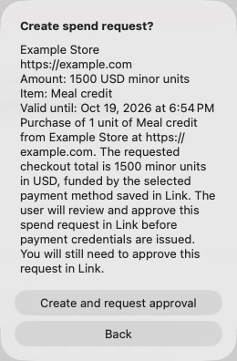
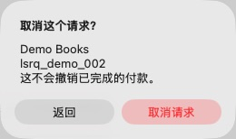

# Link Card 使用说明

[English](USAGE.en.md) | [简体中文](USAGE.zh-CN.md)

Link Card 是 macOS 菜单栏 App，负责创建 Link 付款请求、读取批准后的虚拟卡信息和取消请求。它不会替你在商家网站下单，也不会自动提交商家付款表单。

> 本页截图来自真实界面代码的离线演示窗口。账户、授权短语、请求、商家和卡信息均为虚构示例，不能用于付款。

首次安装请先阅读[安装指南](INSTALL.zh-CN.md)，完成系统要求检查、构建和安装。

## 1. 启动与菜单栏

安装完成后，双击 Applications 中的 **LinkCard.app** 即可。从源码目录试运行时，也可以执行：

```bash
./build.sh
open dist/LinkCard.app
```

启动后，屏幕顶部菜单栏会出现信用卡图标：

- **打开 Link Card**：显示主窗口。
- **退出**：结束 App。

关闭主窗口后，App 仍保留在菜单栏。要再次使用，点击菜单栏图标并选择「打开 Link Card」。App 不会自动设置开机启动。


*主界面：顶部显示登录账户，列表展示请求 ID、金额和状态。*

### 切换语言

窗口顶部提供 **中文 / English** 切换控件。切换后，按钮、菜单栏菜单、确认框、卡信息字段和已有状态提示会即时更新，重启后也会保留选择。商家名称、用途、请求 ID 和卡信息本身不会被翻译。

## 2. 登录 Link

1. 点击窗口右上角 **登录 Link**。
2. 点击 **打开 Link 登录授权 ↗**，进入官方 Link 网站。
3. 在浏览器登录自己的 Link 账户，根据页面要求输入 App 显示的授权短语并完成授权。
4. 返回 App，等待登录完成。右上角的登录按钮会替换为「已登录」和 Link 返回的姓名／邮箱。


*点击授权链接，在官方 Link 页面完成登录；图中短语仅为演示。*

重新打开 App 时会自动检查登录并读取账户信息；如果登录失效且无法自动续期，会重新显示登录按钮。临时网络故障不会直接把已有登录标记为退出，账户信息无法加载时会显示提示。

这是授权 App 访问 Link，和稍后批准某一笔购买请求是两个独立步骤。独立 App 登录保存在 macOS Keychain 中，无需安装 `link-cli`、Node.js 或 npm。

如果本机已有尚未过期的 CLI 登录，App 可以只读复用其 access token，不会修改 CLI 配置或使用 CLI 的 refresh token。提示过期后，点击 App 的「登录 Link」建立独立登录即可。

## 3. 创建付款请求

先在商家网站确认要购买的商品和结账总金额，再回到 App：

1. 选择 **创建 Generate** 页签。
2. 在付款方式旁点击 **加载**。
3. 从下拉列表选择付款方式；选择后，「付款方式 ID」会自动填入。也可以手动填写已有的付款方式 ID。
4. 填写下列信息。


*英文界面示例：金额 `1500` 配合 `usd` 表示 $15.00。*

| 字段 | 怎么填 | 示例 |
| --- | --- | --- |
| 付款方式 ID | Link 中用于支付的付款方式，不是 spend request ID | 从下拉列表选择 |
| 商家名称 | 实际收款商家的名称 | Example Store |
| 商家 URL | 完整的 HTTP/HTTPS 地址 | `https://example.com` |
| 金额 | 币种的最小单位，填写正整数 | USD $15.00 填 `1500` |
| 币种 | 三字母币种代码 | `usd` |
| 可用截止时间 | 以本地日期／时间设置请求到期时间，默认打开表单时的 24 小时以后；「一天以后」可重置 | 明天的当前时间 |
| 商品 | 本次购买内容；当前表单固定数量为 1，商品名不要包含逗号 | Meal credit |
| 用途 Context | 至少 100 个字符，说明买什么、在哪买、金额及用途 | 见下方示例 |

用途示例（请改成符合真实购买的内容）：

```text
Requesting approval to purchase 15 USD of meal credit from Example Store at https://example.com. This request is for the checkout total I reviewed and will be paid using my selected Link payment method.
```

5. 点击 **检查并创建请求…**。
6. 在确认框中核对商家、URL、金额、商品和用途。
7. 点击 **创建并请求批准**。仅填写表单不会提交请求。



*确认框供你检查内容；点击 Back 可以返回修改。*

金额必须结合币种理解。例如 `usd` 下 `10000` 表示 $100.00，而不是 $10,000。请求金额和状态也不等于商家最终结算金额。

选择的截止时间会显示在创建确认框，并作为请求的 `expires_at`（Unix 秒）提交，必须晚于当前时间。它是请求到期时间，不保证卡片能使用到同一时刻：[Stripe 目前说明卡凭证有效期为 12 小时](https://github.com/stripe/link-cli#spend-request-lifecycle)，实际卡片截止时间仍以 Link 返回为准。

## 4. 批准请求并自动显示卡信息

1. 创建成功后，点击 **在 Link 中批准请求 ↗**。
2. 在 Link 官方页面核对并亲自批准本次请求。
3. 保持 App 窗口打开。App 每两秒检查一次状态，最多等待十分钟；发现已批准后自动读取卡信息。
4. 如果没有自动更新，点击 **已批准，刷新卡信息**，或在列表中选中请求后点击 **显示卡信息 Show**。

App 不会替你批准购买请求。等待超过十分钟只表示 App 停止自动检查，不代表请求已取消。

## 5. 查看或复制卡信息

1. 切换到 **请求 / 历史**。
2. 点击 **刷新列表**。
3. 选中要查看的请求。
4. 点击 **显示卡信息 Show**。


*卡信息展示示例：图中全部为虚构数据，不是真实付款凭证。*

下方表格显示以下字段，未返回的字段显示为 `—`：

| 字段 | 含义 |
| --- | --- |
| Spend request ID | 请求 ID，通常以 `lsrq_` 开头 |
| Status | 请求当前状态 |
| Merchant / Merchant URL | 创建请求时填写的商家名称和网址 |
| Context | 购买用途 |
| Created at | 请求创建时间 |
| Card number | Link 返回的虚拟卡卡号 |
| CVC | 虚拟卡安全码，也称 CVV |
| Brand | 卡组织 |
| Expiration | 卡的月份／年份有效期 |
| Billing address | 返回的账单地址 |
| Request expiry | Link 返回的请求到期时间 |
| Valid until | Link 返回的卡凭证实际截止时间；缺失时显示 `—`，与请求到期时间、卡面有效期分别展示 |

可以选中文本后按 **⌘C** 复制到自己的商家结账页面。App 不会自动复制，也不会自动填写商家页面。完整卡号和 CVC 会直接显示在窗口内。

点击 **清除卡信息** 可清空当前显示。关闭窗口也会清除显示并停止自动批准状态检查；不会取消服务端请求。卡响应使用临时网络会话处理，不会写成卡信息 JSON 文件。

## 6. 取消请求

1. 在 **请求 / 历史** 中选中请求。
2. 直接点击该行的 **取消请求**，或使用列表下方的 **取消请求 Cancel**。只有已创建、等待批准或已批准状态可以取消。
3. 核对确认框中的商家和请求 ID，再点击 **取消请求**。
4. Link 确认取消后，App 会清除该请求的卡信息并停止等待批准。请求会从活跃列表移除，打开「包含历史」即可查看；也可以刷新以重新读取服务端状态。



*核对商家和请求 ID，再决定返回或取消；截图没有执行取消操作。*

服务端可能拒绝取消某些状态的请求，App 会显示错误。

## 7. 查看历史

打开 **包含历史**，列表会重新读取历史请求，包括取消、过期等非活跃请求。选中记录后可以尝试显示详情，但过期或已结束的请求不保证还能返回完整卡信息。

这里是 **spend request 历史**：列表金额是请求中记录的金额，不是专门查询的商家实际扣款金额。当前 App 没有独立的商家交易流水、退款追踪或对账页面。核对实际扣款时，请结合商家收据和原付款方式最终入账记录。

## 常见问题

| 情况 | 处理方式 |
| --- | --- |
| 没有活跃请求 | 打开「包含历史」，或创建新请求 |
| 付款方式列表为空 | 确认登录账户正确，点击「加载」；根据 Link 返回的提示处理账户或付款方式问题 |
| 创建按钮不可点击 | 检查必填字段、用途是否达到 100 字符，以及是否仍有操作在进行 |
| 提示金额或 URL 无效 | 金额填写正整数最小单位；URL 必须带 `http://` 或 `https://` |
| `pending_approval`，没有卡号 | 打开本次请求的批准链接，完成批准后刷新 |
| 登录过期、HTTP 401 | 点击「登录 Link」重新授权，再刷新 |
| 卡号、地址或 CVC 显示 `—` | 该次响应没有提供此字段；确认状态和批准情况，不能从 `—` 推断真实卡信息 |
| 关闭窗口后看不到卡信息 | 从菜单栏重新打开，选择请求并点击「显示卡信息 Show」 |
| 请求创建后出现错误 | 先刷新列表及历史，确认是否已创建，避免直接重复提交同一笔请求 |

## 当前范围

- Apple Silicon、macOS 13 或更新版本。
- 支持中文和 English 即时切换，并保存语言偏好。
- 每个创建请求包含一项商品，数量固定为 1。
- 不自动下单、不自动批准、不自动启动、不提供退款操作。
- 当前构建采用本地 ad-hoc 签名，没有 Apple 公证。
